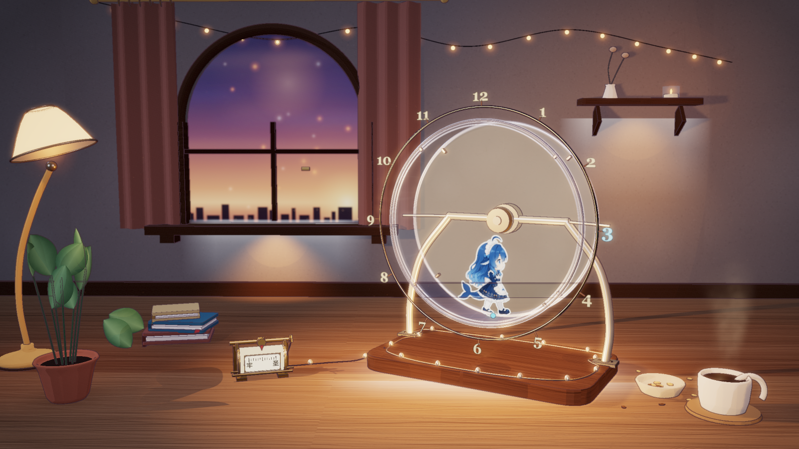

# 暖光玻璃仓鼠跑轮 · Golden Hour Glass Wheel

一个可运行在浏览器与 Wallpaper Engine Web 壁纸中的 Three.js 场景：黄昏房间、玻璃仓鼠跑轮、真实走路帧、桌面滑动变阻器、联动装饰光、冷蓝时间显示与原创氛围纯音乐。



## 功能

- **玻璃跑轮**：透明滚筒、前缘玻璃、后置毛玻璃背板、香槟金支架与带刻度的固定钟面。
- **人物动画**：11 帧原始 PNG 合成 3072×3072 无损精灵图，按 12 fps 播放，默认 0.35 倍慢速散步；脚底固定接触轨道，不随轮体翻转。
- **同步轮体**：人物帧与轮体转角共用连续累积的 `animTime`，不重置相位。
- **滑动变阻器**：鼠标沿滑轨投影移动，控制速度与装饰光；带「牢 / 圣」两端标记、刻度、指针、接线柱和尾线小灯。
- **四种联动光区**：底座下缘、窗台下方、置物架下方、控制器尾线；与轮缘光、底座灯串、木面光斑统一控制。
- **冷蓝时间**：仅当前小时和分钟光点保持冷蓝，其余小时为暖色；8、9、10 点已做前移与深度修复。
- **氛围音乐**：96 秒原创无人声纯音乐，循环播放，首次交互可启动。
- **Wallpaper Engine 工程**：`project.json`、Web 类型、Balance 用户属性、1920×1080 预览。

## 快速开始

要求：Node.js 18+。无需 npm 依赖。

```bash
node build.mjs
```

生成：

- `wallpaper/index.html`：完整单文件页面，精灵图已内嵌
- `wallpaper/assets/ambience.mp3`

直接用浏览器打开 `wallpaper/index.html`。如果浏览器阻止音频自动播放，点击页面一次即可。

### 本地 HTTP（可选）

```bash
python -m http.server 8000
```

访问 `http://127.0.0.1:8000/wallpaper/`。

## Wallpaper Engine

1. 打开 Wallpaper Engine。
2. 选择 **Create Wallpaper → Web**，或 **Open → project.json**。
3. 指向 `wallpaper/` 文件夹。
4. 项目名为 **Golden Hour Glass Wheel**。
5. 可在编辑器调整 **Balance (Speed & Light)**，默认 0.5。

详见 [Wallpaper Engine 文档](docs/04-WallpaperEngine.md)。

## 交互

| 输入 | 行为 |
|---|---|
| 鼠标在控制器区域移动 | 滑块跟随滑轨位置，速度与灯光平滑变化 |
| 鼠标离开控制器 | 保留当前值 |
| 触屏按住滑块拖动 | 同等操作 |
| Wallpaper Engine Balance 属性 | 无鼠标输入时的替代控制 |

滑块映射：

```text
t = 0.0  → 0.8×，青蓝，45% 亮度
t = 0.5  → 1.0×，暖白，100% 亮度
t = 1.0  → 1.2×，淡紫，45% 亮度
```

## 调试参数

| 参数 | 说明 |
|---|---|
| `?clock=15:28` | 固定显示时间，便于截图 |
| `?t=8` | 固定场景时间，暂停动态时间 |
| `?control=0` | 初始滑块左端 |
| `?control=1` | 初始滑块右端 |
| `?q=low` | 低分辨率渲染 |
| `?view=wheel` | 预设视角 |

## 目录

```text
.
├─ src/                 # 分模块源码
├─ assets/              # 无损精灵图与原始音频
├─ wallpaper/           # 可导入 Wallpaper Engine 的 Web 工程
├─ docs/                # 中文设计、构建、壁纸与验证文档
├─ build.mjs            # 单文件构建脚本
└─ README.md
```

## 文档

- [场景与视觉设计](docs/01-场景与视觉设计.md)
- [交互、时间与灯光系统](docs/02-交互与灯光系统.md)
- [构建与运行](docs/03-构建与运行.md)
- [Wallpaper Engine 壁纸工程](docs/04-WallpaperEngine.md)
- [验证记录与已知限制](docs/05-验证记录.md)
- [素材、音乐与来源说明](docs/06-素材与来源.md)
- [N1N 图像生成工具（Agent）](docs/07-图像生成工具.md)

## N1N 图像生成工具

仓库内提供 Agent 可调用的 N1N 图像生成 CLI：

```bash
export N1N_API_KEY="..."
node tools/llm-image-tool.mjs --prompt "..." --size 1536x1024 --download
```

- CLI：`tools/llm-image-tool.mjs`
- 工具描述与 JSON Schema：`tools/llm-image-tool.tool.json`
- 详细文档：`docs/07-图像生成工具.md`
- 本地 mock 测试：`node tools/test-llm-image-tool.mjs`

API Key 只从环境变量读取，不要写入命令参数或提交记录。

## 已知限制

- 未在本机 Wallpaper Engine 客户端内导入验证；项目结构与属性事件已在浏览器中验证。
- 桌面壁纸的鼠标输入是否可用取决于 Wallpaper Engine 设置；不可用时使用 Balance 属性。
- 浏览器通常阻止无手势音频自动播放，需点击一次；Wallpaper Engine 是否放行取决于运行环境。
- 灯光使用少量实际光源和贴面柔光近似，不是全局光照。
- 视频与 ZIP 属于发布产物，不放入源码仓库。

## 素材说明

- 角色 11 帧行走素材由项目提供者提供；本仓库只做拼图与播放，不重绘。
- 氛围音乐由本项目程序化合成，无第三方采样。
- Three.js r149 为 MIT 许可。
